# TermClaw

Desktop app for Windows and macOS that keeps many AI coding agents running in parallel across projects and machines — in terminals (local, SSH, WSL, with tmux) or as structured agent sessions with a chat view (OpenCode, GitHub Copilot and other ACP agents). A built-in MCP server lets other agents (Claude Code, claude.ai, your own tools) see and drive the sessions, and orchestrators can coordinate them on their own.

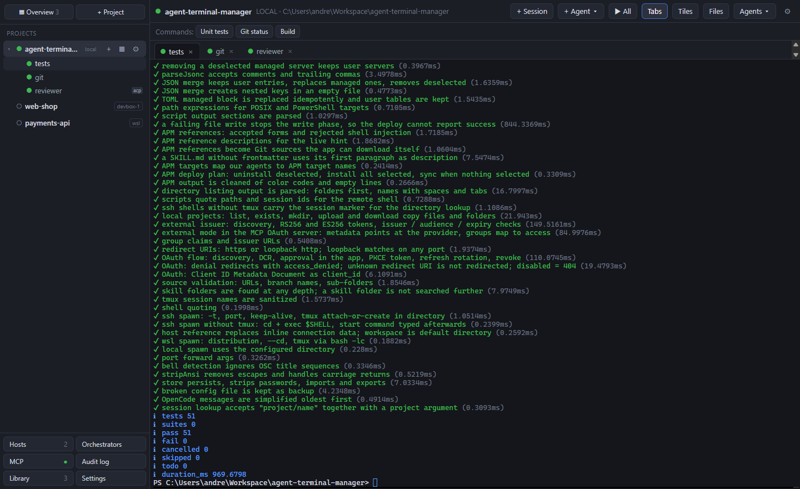

## Features

- **Projects and sessions** — local PowerShell / shell, SSH and WSL terminals; one tmux session per terminal so agents keep running when the connection drops; auto-reconnect, keep-alive, port forwarding and X11 forwarding (on Windows through WSLg).
- **Tabs, tiles and overview** — a project's sessions as tabs or 2/3/4/grid tiles; an overview of every running session in every project.
- **Status and notifications** — working (yellow) / waiting (green) from output pauses or the terminal bell, exact status for agent sessions; desktop notification when an agent is done or waits for you.
- **Agent sessions with a chat view** — OpenCode (server API) and any agent speaking the Agent Client Protocol: OpenCode, GitHub Copilot CLI or your own command. Markdown answers, compact tool calls, model and mode picker, slash commands, permission cards, approval level, live token usage.
- **Files** — drop files onto a terminal to copy them into the shell's current directory on the remote machine; a file browser to download and upload.
- **Docker** — a lightweight Portainer per project: dashboard with containers, CPU, memory and disk, live stats, start / stop / restart / pause / kill / remove (also for a selection), logs, a shell in a container, images and volumes with removal and cleanup — over the project's own SSH / WSL connection, without opening a port.
- **Monitor** — a host monitor for Linux machines (SSH, WSL, local Linux): CPU with per-core load, memory and swap, disk and network I/O, disk usage per mount point and the running programs, with live charts.
- **PowerShell remoting** — a project type for Windows machines over WinRM (`Enter-PSSession`), with a connection test and step-by-step setup help in the project editor.
- **MCP server** — tools to list, read, prompt and wait for sessions, open sessions, run commands and create projects; app tokens for local clients, OAuth sign-in (built-in with approval in the app, or authentik / Keycloak / Entra ID) for claude.ai.
- **Coding agents** — install Claude Code, Codex, OpenCode, Antigravity, Copilot, pi, Cursor and Qwen Code, and deploy MCP servers, skills (also from Git repositories) and APM packages to them, per project, on the project's machine.
- **Orchestrators** — OpenCode-based coordinators that react when watched sessions finish (e.g. developer + reviewer loops), with round limits, pause and stop.
- **Developer hosts** — a directory of your Linux machines with reachability and session counts; projects reference a host.
- Saved commands per project, drag & drop ordering of projects and sessions, keyboard shortcuts, audit log of every MCP and orchestrator action, JSON export / import.

## Install

Download the latest build from the GitHub **Releases** page of this repository:

- **Windows x64:** `TermClaw Setup <version>.exe` (installer) or `TermClaw <version>.exe` (portable). The builds are not code-signed; SmartScreen asks once (*More info → Run anyway*).
- **macOS Apple silicon:** `.dmg` or `.zip`. Not notarized: after copying the app to Applications run `xattr -dr com.apple.quarantine "/Applications/TermClaw.app"` once.

Requirements on the machines you connect to: `ssh` with key authentication (your `~/.ssh/config` and ssh-agent are used), `tmux` for persistent sessions, and the agents you want to run.

## Projects, sessions and views

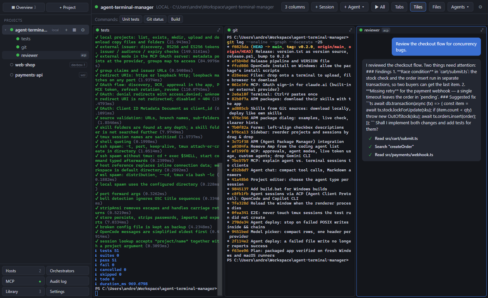

- **Left:** the project tree — projects with a status dot and their sessions. `+` opens the project's default session, `▦` toggles tiles, `⚙` edits the project. Drag projects and sessions to reorder them. Right-click for more: rename, share with MCP, mark as orchestrator, browse files, reconnect, close with or without killing the tmux session.
- **Right:** the project's sessions as **tabs** or **tiles** (2 = side by side, 3 = three columns or one large + two small, 4 = 2×2, more = grid). Clicking a tile header returns to the single view.
- **Overview:** all running sessions of all projects, grouped per project. Tiles shrink via the font size, so text stays sharp. Click a tile to open the session.
- **Status:** *working* (output within the last *n* seconds) and *waiting* (no output for longer than the threshold — default 5 s, per project — or a bell character). Agent sessions report their status exactly. Switching to *waiting* sends a desktop notification; clicking it opens the session.
- **Saved commands** per project appear as buttons above the terminal and run in the active session. **▶ All** starts all terminals configured for the project.
- Sessions stay connected when you switch projects. Open sessions, view mode and tile layout are restored on restart; with tmux the app re-attaches to the sessions that kept running.

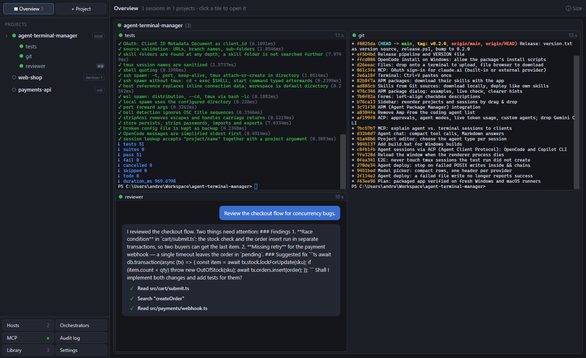

The project editor sets the connection (local, SSH, WSL, or a developer host), start directory, tmux, auto-reconnect, status threshold, the default session and its type (terminal, OpenCode, OpenCode via ACP, Copilot via ACP, custom ACP agent), the terminals for **▶ All**, saved commands, port forwards and the coding agent setup.

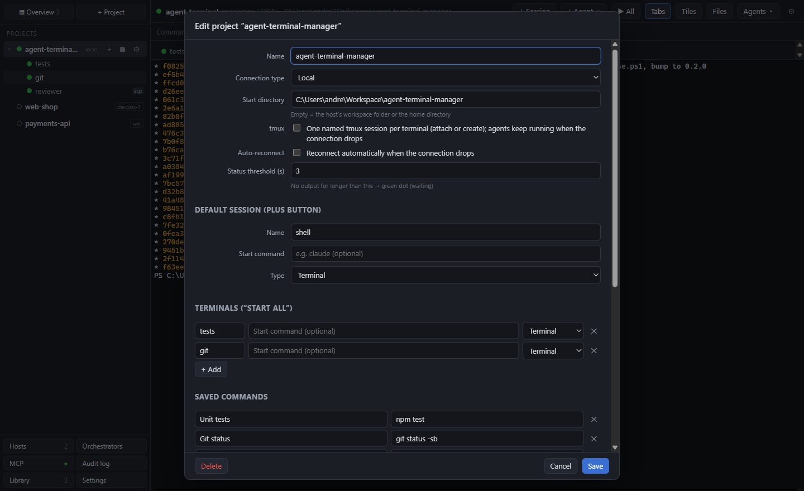

### Keyboard shortcuts

| Shortcut | Action |
|---|---|
| Ctrl/⌘ + Shift + T | new session |
| Ctrl/⌘ + 1…9 | switch project |
| Ctrl/⌘ + Tab | next session |
| Ctrl/⌘ + Shift + G | tile view |
| Ctrl/⌘ + Shift + O | overview |
| Ctrl/⌘ + Shift + W | close session |
| Ctrl/⌘ + Plus / Minus / 0 | larger / smaller / reset font of the terminal (also Ctrl/⌘ + mouse wheel and the session context menu; kept per session) |
| Ctrl/⌘ + Shift + C / V | copy / paste (Ctrl + C copies a selection, Ctrl + V pastes on Windows) |

## Connections

| Type | Command |
|---|---|
| Local | PowerShell (Windows) or `$SHELL -l` (macOS) in the start directory |
| SSH | `ssh -t [-p port] [-o ServerAliveInterval=30 -o ServerAliveCountMax=3] user@host '<script>'` — the script changes into the directory and attaches to (or creates) the tmux session `termclaw-<project>-<session>`, running the start command on creation. Without tmux: `cd <dir> && exec $SHELL -l`. |
| WSL | `wsl.exe -d <distribution> --cd <path> [-- bash -lc '<tmux script>']` |
| OpenCode server | `opencode serve` (locally directly, on SSH/WSL targets inside tmux), reached over its HTTP API; SSH targets via `ssh -L`. |
| ACP agent | the agent process (`opencode acp`, `copilot --acp`, …) with JSON-RPC over stdin/stdout — locally as a child process, on SSH/WSL through the same connection. |

Authentication uses SSH keys, ssh-agent and your own `~/.ssh/config` only (host aliases work as hostnames). No passwords are stored; fields such as `password` are stripped on save and import. Port forwarding per SSH project (local port → remote port) runs as a separate `ssh -N -L …` process while at least one session of the project is running.

### X11 forwarding

SSH projects can show remote X11 programs locally (project editor → *X11 forwarding*):

| Setting | Session command | Local X server |
|---|---|---|
| Through WSL (WSLg), Windows | `wsl.exe -d <distribution> --exec ssh -Y -t … user@host '<script>'` | WSLg, built into WSL 2 |
| Windows X server / On (macOS, Linux) | `ssh -Y -t …` with `DISPLAY` (default `localhost:0.0` on Windows) | VcXsrv, X410, XQuartz or the desktop's own |

WSLg's X server is only reachable from inside WSL, so the *Through WSL* setting runs the session with the ssh client of the chosen distribution: its `~/.ssh` keys, `~/.ssh/config` and `known_hosts` apply, not the Windows ones. File transfer, port forwarding and tmux cleanup keep using the Windows ssh client, so the host must accept the keys of both. The server needs `X11Forwarding yes` in `sshd_config` and `xauth` installed. With tmux, reattaching updates `DISPLAY` for new tmux windows; shells that were already open keep the old value (`export DISPLAY=…` or open a new window).

## Agent sessions

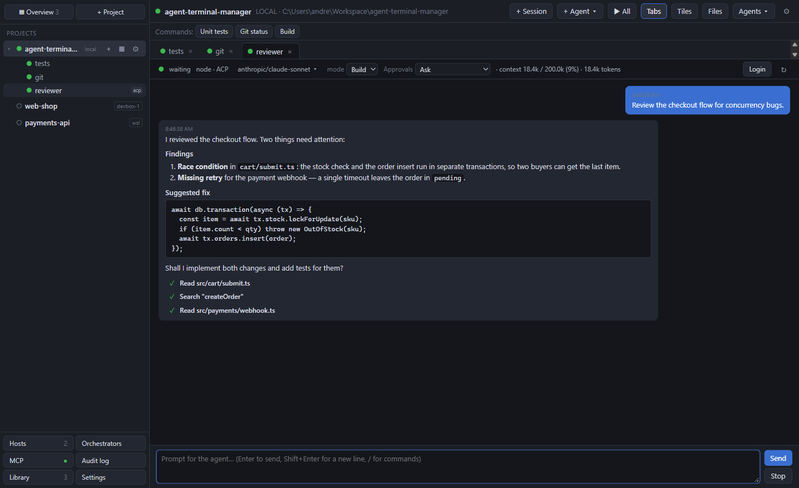

**+ Agent ▾** in the project header starts a structured agent session with a chat view:

- **OpenCode (server API):** `opencode serve` over HTTP.
- **OpenCode via ACP** (`opencode acp`), **GitHub Copilot via ACP** (`copilot --acp`), or any other **ACP agent** you enter as a command in the project editor.

The chat shows streamed Markdown answers and compact tool calls. The status bar has the **model** picker, the agent's own options (e.g. *mode*), the **approval level** (*Ask* for every tool call, *Auto-approve reads*, or *Auto-approve all*; auto-answers are logged in the chat), live **token usage** (context window and tokens used, growing while the agent works) and **Login** (opens a terminal with `opencode auth login` or `copilot login`). Slash commands: `/model`, `/new`, `/stop`, `/login`, `/help` plus the agent's own commands, with autocomplete. When the agent asks for permission, a card with its options appears and the session counts as *waiting*. The conversation and model are restored after a restart (`session/load`).

ACP agents are implemented in `src/main/acp.js`; another built-in agent is one entry in `ACP_AGENTS`. ACP sessions do not run in tmux, so a dropped SSH connection ends the agent process (Reconnect resumes the conversation).

## Files

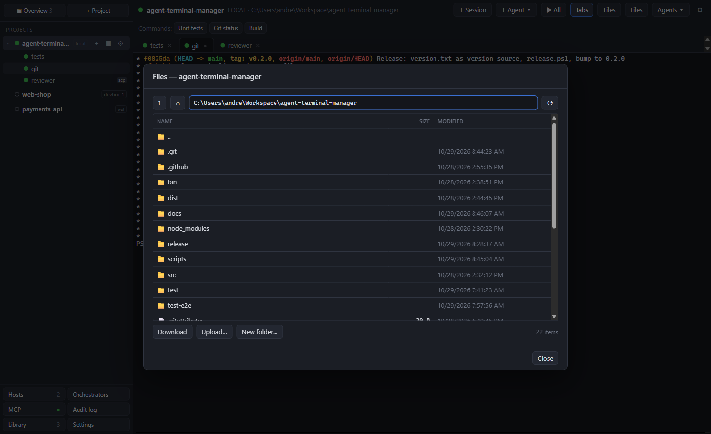

- **Drop files onto a terminal** (from the Explorer / Finder) to copy them to the project machine, into the directory the shell is in right now. Folders work too. If a name already exists you are asked before it is replaced. On a local terminal the file paths are typed in instead.
- **Files** in the project header (or *Browse files…* in the context menu) opens a file browser in the shell's current directory or the project folder. Double-click opens folders and downloads files; select several entries (Ctrl / Shift) and click **Download** to copy them into a local folder. **Upload…** or dropping files onto the list copies them into the folder shown; **New folder…** creates one.

SSH and WSL transfers run over `ssh` / `wsl.exe` with the terminal's connection settings: files are streamed with `cat`, folders with `tar`; a file is written under a temporary name and renamed when complete. The shell's directory comes from the shell itself (OSC 7), from tmux (`pane_current_path`), or on Linux from the shell process marked with `TERMCLAW_SID`; otherwise the project folder is used.

## Monitor

Turn on **Monitor** in the project editor and the project gets a **Monitor** tab (sidebar and project header) for the machine behind the project — an SSH host, a WSL distribution or this computer when it runs Linux:

- **Cards** — CPU (user / system / iowait, per-core bars), memory with cache and swap, disk I/O and network I/O, each with a two-minute chart.
- **Basic information** — host name, system, kernel, architecture, CPU model, uptime, load average, number of processes.
- **Disk usage** — size, used and free per volume and mount point (pseudo file systems are hidden; *show all mounts* adds boot, snap and container mounts).
- **Disk I/O** — read / write throughput, IOPS and busy time per block device. **Network I/O** — throughput and totals per interface.
- **Programs** — the busiest processes with CPU, memory, threads and command line; sortable and filterable by command, user or PID.

How it works: one process on the machine prints a sample of `/proc` every 2 seconds over the project's connection (`ssh … sh -c`, `wsl.exe --exec bash`), and TermClaw computes the rates from consecutive samples. Nothing is installed on the machine and no port is opened; the process stops 15 seconds after you leave the tab.

## PowerShell remoting (Windows machines)

Choose **PowerShell remoting (WinRM)** as the connection type of a project (Windows version of TermClaw). A session runs a local PowerShell that connects with `New-PSSession` / `Enter-PSSession`; the start directory is set on the remote machine. You get a remote PowerShell prompt, not a full terminal: interactive console programs and coding agents do not work there — enable OpenSSH on the Windows machine and use an SSH project for those. Docker, Monitor, the file browser and agent setup are not offered for this type.

The project editor has **Test connection** (port, WinRM service, TrustedHosts, with hints for what to fix) and **Setup help…**. In short:

1. On the remote machine, PowerShell as administrator: `Enable-PSRemoting -Force` (on a “Public” network add `-SkipNetworkProfileCheck` and open the firewall rule `WINRM-HTTP-In-TCP`).
2. The user must be an administrator or in “Remote Management Users” (local accounts: `MACHINE\user`).
3. Outside an Active Directory domain, on this computer as administrator: `Set-Item WSMan:\localhost\Client\TrustedHosts -Value <host> -Concatenate -Force`, or use HTTPS (port 5986, certificate on the remote machine; tick “Accept self-signed certificates” for a self-signed one).

No password is stored: with a user name the password is asked in the terminal, without one the current Windows account is used.

## Docker

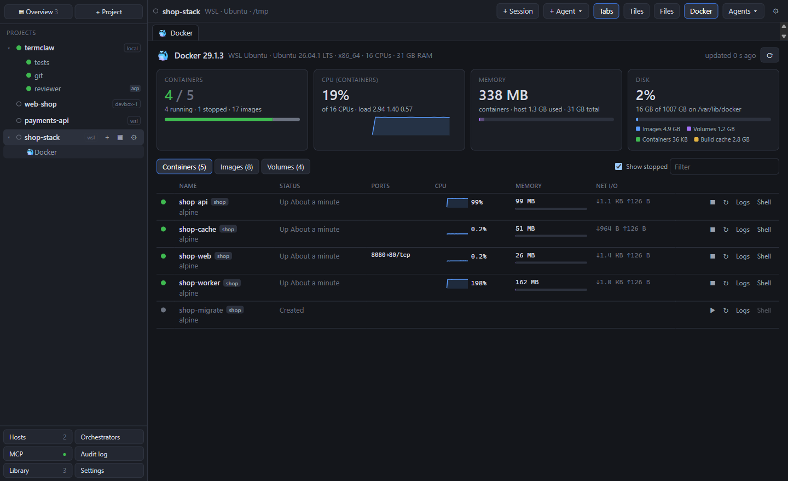

Turn on **Docker** in the project editor and the project gets a **Docker** tab (also in the sidebar and the project header):

- **Dashboard** — running / stopped containers, CPU of all containers (with history), memory used by containers and on the host, disk usage of the filesystem that holds Docker's data, split into images, volumes, containers and build cache, plus the host's load.
- **Containers** — state, image, compose project, published ports, live CPU (with sparkline), memory against the limit and network I/O, updated every 3 seconds. **■ / ▶ / ↻** stop, start and restart; **⋯** pauses / resumes, kills or removes; **Logs** opens a live log view (tail length, follow, timestamps, wrap, copy); **Shell** opens a terminal session in the project running `docker exec -it <container>` with bash, or sh when there is no bash.
- **Images** and **Volumes** — size, tags, which containers use them, mount points; **✕** removes one.
- **Sorting** — click a column header (name, status, CPU, memory, network, size, containers, used by, created, …) to sort; click again to reverse. The choice is remembered per list.
- **Several at once** — tick the checkboxes (Shift+click selects a range, the header box selects everything shown) and use the bar above the list: start, stop, restart, pause, resume, kill or remove the selected containers, remove the selected images or volumes. Each item is tried; failures are listed with Docker's message (e.g. a volume still in use). Removing asks first and offers *force* (stop running containers / remove images stopped containers still reference) and, for containers, removing their anonymous volumes.
- **Cleanup** — *Remove stopped…* for containers, *Remove unused…* for images (untagged only, or every image without a container) and volumes (anonymous only, or named ones too); shows how much space was freed.

How it connects: TermClaw speaks the Docker Engine API through `docker system dial-stdio`, run on the project machine over the project's connection (`ssh … docker system dial-stdio`, `wsl.exe --exec docker system dial-stdio`, or locally) — the transport Docker itself uses for `DOCKER_HOST=ssh://`. Nothing listens on a local port (a forwarded Docker socket would give every local process root-equivalent access), and Docker contexts and rootless setups work as on the command line. The Docker CLI must be installed on the project machine and the user allowed to use the engine (e.g. member of the `docker` group); another CLI path can be set in the project editor. Polling only runs while the tab is visible; the connections close a minute after you leave it. Every action and cleanup is recorded in the audit log.

## MCP server

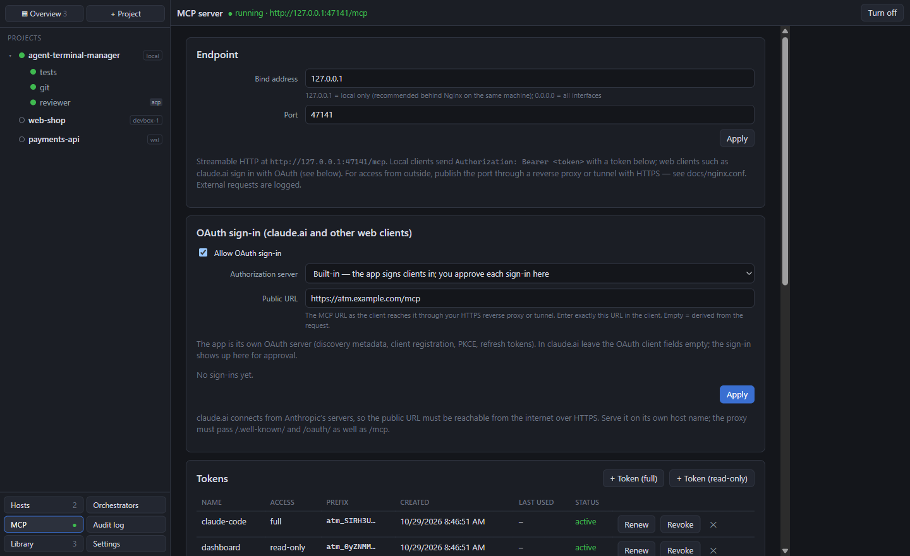

Streamable HTTP at `http://127.0.0.1:47900/mcp` (bind address and port configurable, can be turned off). Every request needs `Authorization: Bearer <token>`: a token created in the app (full or read-only, stored as a hash, revocable and renewable) or an OAuth access token.

| Tool | Purpose |
|---|---|
| `list_projects`, `list_sessions` | projects and sessions with status and kind (agent or terminal) |
| `send_to_session` | send a prompt / text to a session (with Enter) |
| `read_output` | last N lines or output since a marker; agent sessions return messages |
| `wait_until_idle` | blocks until the session is waiting (with timeout) |
| `wait_for_any_idle` | blocks until one of several sessions is done |
| `open_session` | open a session (default configuration, optionally an agent) |
| `run_command` | run a saved command |
| `list_hosts`, `find_free_host` | host directory, find a free host |
| `create_directory` | create a directory in a host's workspace folder |
| `create_project` | create a project on a host and open a session with a start command |

Resources: `session://<project>/<name>/status`, subscribable. The server instructions tell clients to prefer agent sessions for delegating work and terminals for shell commands. Permissions on the MCP page enable actions with side effects individually; by default only sessions shared with MCP are visible, and orchestrator sessions are never a target. All MCP, orchestrator and external requests go to the **Audit log** and `audit.log`.

Connect Claude Code:

```bash
claude mcp add --transport http termclaw http://127.0.0.1:47900/mcp --header "Authorization: Bearer <token>"
```

Clients that only speak stdio use the bridge `dist/termclaw-mcp-stdio.js` (`TERMCLAW_MCP_TOKEN=<token> node dist/termclaw-mcp-stdio.js [url]`).

### OAuth sign-in (claude.ai and other web clients)

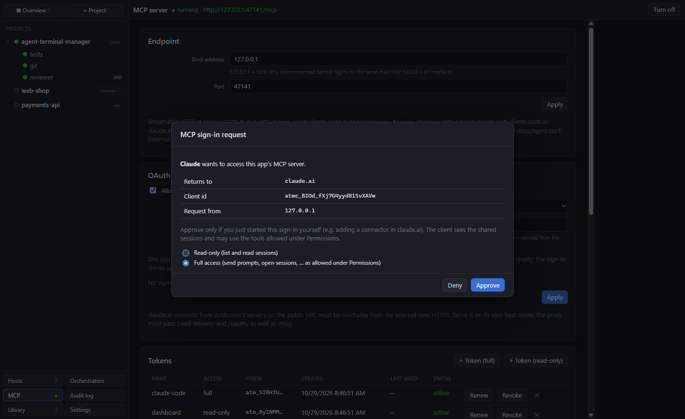

claude.ai connectors sign in with OAuth 2.1 and cannot send a fixed `Authorization` header. Turn on **Allow OAuth sign-in** on the MCP page, set the **Public URL** (the HTTPS URL of `/mcp` behind your reverse proxy or tunnel, e.g. `https://termclaw.example.com/mcp`) and pick the authorization server:

- **Built-in:** the app is its own authorization server (RFC 9728 / RFC 8414 metadata, Client ID Metadata Documents and Dynamic Client Registration, PKCE S256, rotating refresh tokens). When a client signs in, the app shows who wants access and where it returns to; you approve with read-only or full access, or deny. Approved sign-ins are listed and can be revoked. In claude.ai choose *Use Claude's published identity*.
- **External identity provider** (authentik, Keycloak, Entra ID, …): the provider signs users in, the app validates its JWT access tokens (JWKS signature, issuer, expiry, `aud`/`azp` among the allowed client ids) and maps a group claim to access (required group, group with full access). **Test provider** checks discovery and keys. Providers without automatic client registration (e.g. authentik): create an OAuth2/OpenID application with redirect URI `https://claude.ai/api/mcp/auth_callback` and enter its client id under *Advanced settings* in claude.ai.

In claude.ai: **Customize → Connectors → Add custom connector** with the public URL. claude.ai connects from Anthropic's servers (`160.79.104.0/21`), so the public URL (and an external provider) must be reachable from the internet. The proxy must pass `/mcp`, `/oauth/` and `/.well-known/oauth-*`; [docs/nginx.conf](docs/nginx.conf) has examples for a dedicated host name and for a path prefix.

## Coding agents: install, MCP servers, skills and APM

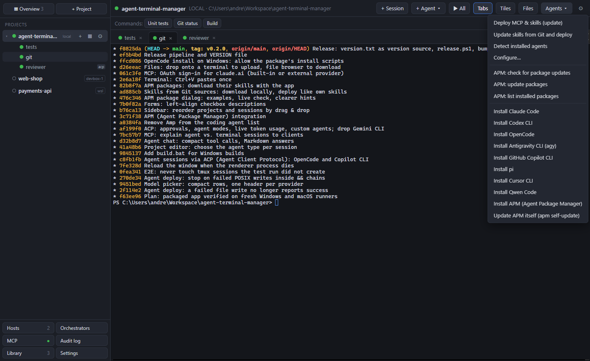

**Agents ▾** in the project header installs coding agents and deploys MCP servers, skills and APM packages to them. Supported agents: Claude Code, Codex CLI, OpenCode, Antigravity CLI (agy), GitHub Copilot CLI, pi, Cursor CLI and Qwen Code.

- **Install** types the agent's official install command into the active terminal (PowerShell variant for local Windows projects, shell variant for macOS/Linux, SSH and WSL), so you see the output and can answer prompts.
- **Library** (sidebar): MCP servers (stdio command or HTTP URL; env vars and headers are encrypted with the OS keychain), your skills folder (`<name>/SKILL.md` + files), Git sources for skills and APM packages.
- **Project editor → Coding agents:** pick MCP servers, skills and APM packages for the project, the target agents (all installed, or a selection) and the scope (project folder or home directory).
- **Deploy MCP & skills (update)** detects the installed agents on the project's machine and writes each agent's own config format (e.g. `.mcp.json` and `.claude/skills` for Claude Code, `opencode.json` for OpenCode, `~/.codex/config.toml` for Codex). Your own entries are never changed; deselected servers and skills are removed on the next deploy. What was deployed is recorded in `.termclaw/deployed.json`.

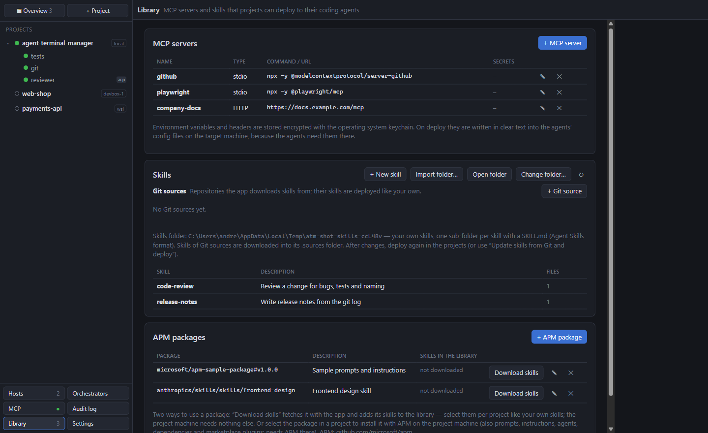

**Skills from Git:** Git sources (https or ssh URL, or GitHub shorthand `owner/repo[/path][#ref]`, optional branch/tag and sub-folder) are downloaded with your local git into the skills folder. Every folder with a `SKILL.md` becomes a skill and is deployed like your own; the target machines need no Git access. **Agents ▾ → Update skills from Git and deploy** does both in one step. Name conflicts are marked and not deployed.

**APM packages** ([Agent Package Manager](https://github.com/microsoft/apm)): references such as `microsoft/apm-sample-package`, `owner/repo/path#v1.2`, `plugin@marketplace` or a Git URL. Two ways to use one: **Download skills** fetches the package with the app and adds its skills to the library; or select the package in a project, and Deploy installs it with APM on the project machine (uninstalls deselected packages, `--target` set to the agents found). **Agents ▾** also checks for and installs package updates, lists installed packages and installs or updates APM itself.

Codex and Copilot read MCP servers only from the home directory; use the user scope for them. Every agent is one adapter in `src/main/coding-agents/registry.js` on a shared interface (`base.js`); the runner (`deploy.js`) does one read and one write pass over PowerShell or `sh`.

## Orchestrators

Under **Orchestrators** you create coordinators, each with a name, system prompt (templates *Developer + reviewer*, *Watch*), model, maximum rounds and the watched sessions. On start the app launches its own `opencode serve`, registers the app's MCP server with a token limited to those sessions, and creates an OpenCode session with the system prompt. When a watched session finishes, the event and its latest output go to the orchestrator as a message (queued if it is busy). Brakes: maximum rounds, pause, interrupt, stop. A session can only belong to one orchestrator.

## Developer hosts

Under **Hosts** you register your development machines once (name, hostname, port, user, workspace folder, tags). Projects reference a host. The app checks reachability every 30 s and counts sessions per host; *Check SSH* also counts the tmux sessions there. MCP clients can find a free host and create projects on it.

## Data

`config.json`, `audit.log` and orchestrator working folders live in the app data folder (Settings → Open data folder). Export / import as JSON via Settings or the File menu; tokens and OAuth grants are not exported.

## Development

```bash
npm install
npm start
```

On Windows, `build.bat` does all steps: `build.bat` builds the installer, portable exe and unpacked app, `build.bat dir` only the unpacked app (`release\win-unpacked`), `build.bat test` runs the unit tests first. Packages for one platform: `npm run dist:win` or `npm run dist:mac` (macOS packages must be built on a Mac).

Tests:

```bash
npm test
```

```bash
npm run e2e
```

The E2E script drives the real app through Playwright. Environment variables enable additional parts: `TERMCLAW_E2E_SSH=user@host:port` (SSH target with key login and tmux), `TERMCLAW_E2E_WSL=Ubuntu`, `TERMCLAW_E2E_OPENCODE=1` (agent sessions and orchestrators; needs a working OpenCode model), `TERMCLAW_E2E_COPILOT=1`, `TERMCLAW_E2E_APM=1`, `TERMCLAW_E2E_DOCKER=1` (Docker tab against the Docker engine in the WSL distribution; needs the `alpine` image there).

Screenshots for this README are taken from the real app with a demo setup:

```bash
npm run build:renderer && node scripts/screenshots/take.js
```

The app icon is drawn in `build/icon.svg`; after changing it, render `build/icon.ico` (Windows), `build/icon.png` (macOS) and `src/main/icon.png` (window icon) with:

```bash
npx electron scripts/make-icon.js
```

Stack: Electron, xterm.js, node-pty, `@modelcontextprotocol/sdk`, OpenCode (server API), Agent Client Protocol.

### Versions and releases

The release number is in [`version.txt`](version.txt). Every build copies it into `package.json`, so the app, the exe file version and the file names use it. To publish a release, edit `version.txt` (e.g. `0.3.0`) and run:

```powershell
.\release.ps1
```

The script checks that you are on an up-to-date `main` with no other uncommitted changes and that the tag does not exist yet, writes the version into `package.json`, runs the unit tests, commits, asks for confirmation, pushes `main` and the tag `v<version>`. `-DryRun` only shows what it would do.

The tag starts `.github/workflows/release.yml`: it checks that the tag is on `main` and matches `version.txt`, builds the Windows x64 installer and portable exe and the macOS Apple silicon dmg and zip, starts each packaged app once, and creates the GitHub release. `.github/workflows/build.yml` (manual start) runs the full test suite on Windows and macOS.

## License

MIT — see [LICENSE](LICENSE).
